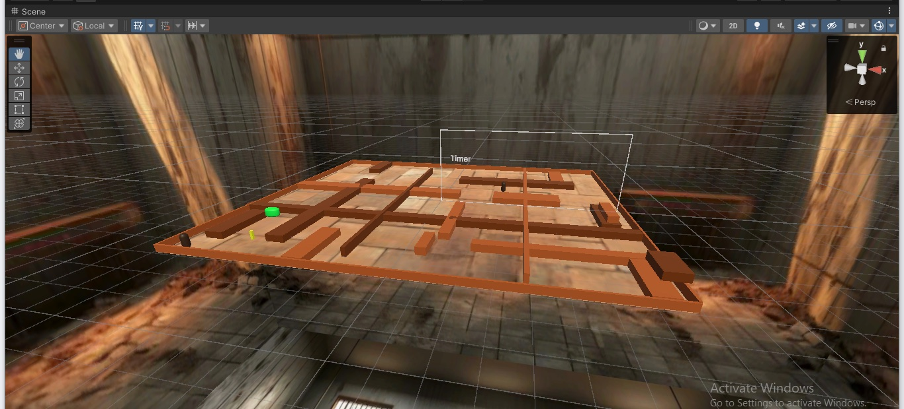
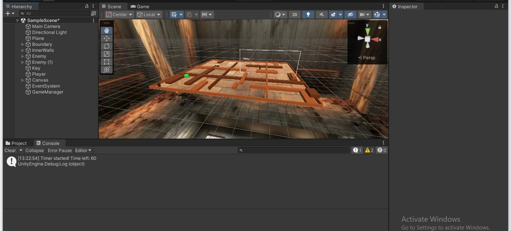
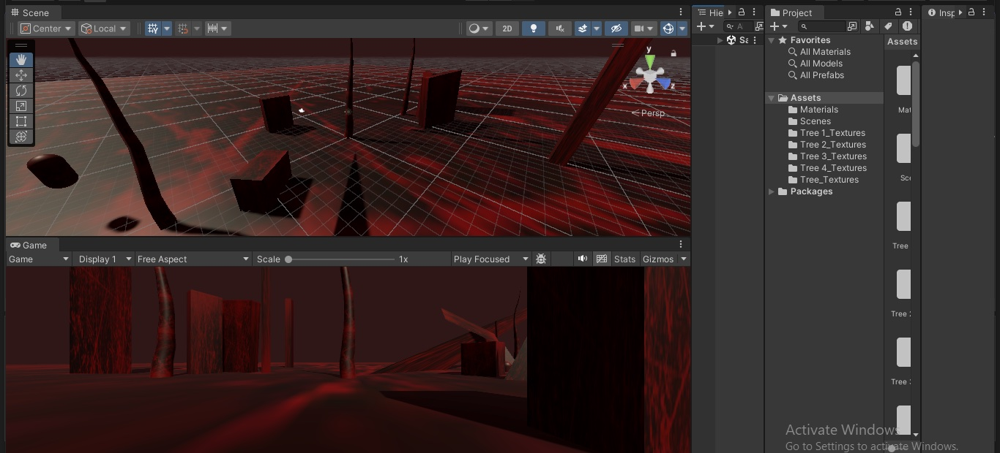
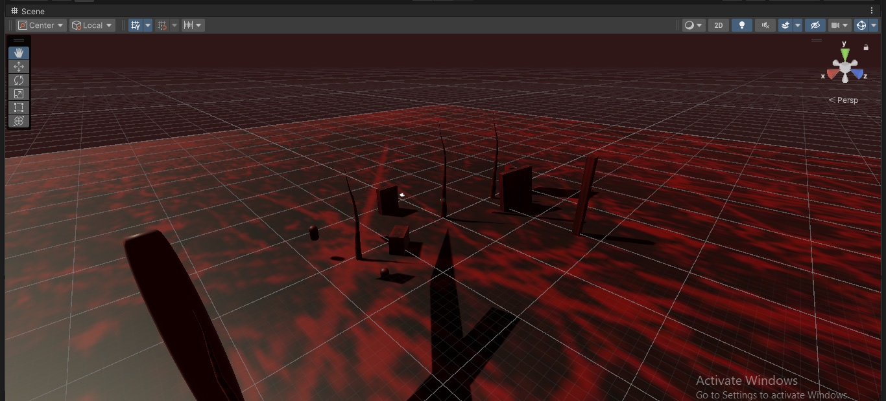
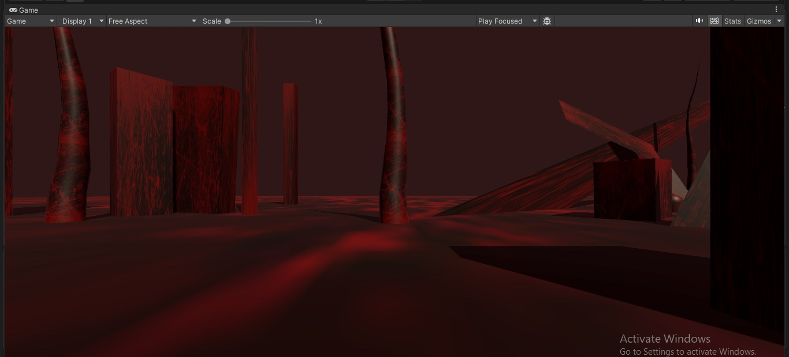

# Unity Level Design

Level design and scene setup in Unity 2022.3: a timed maze level built from
blocked-out geometry, and an atmospheric set dressed with custom lighting and
tree meshes. Second-year game design coursework.

**Status:** archived coursework, documented and organized for source review.
**Engine:** Unity 2022.3.47f1 / C#.

## Level design reel

[Watch the reel](docs/media/level-design.mp4) (29 seconds). Scene views of both
levels, taken from the editor: the maze blockout with its hierarchy and the
lit atmospheric set.

## The maze level

The playable level. The floor plate is laid out as a grid of corridors and dead
ends, walled with box geometry and bounded by a timber room so the camera always
has something behind the play space.

What the scene holds, as composed in the hierarchy: a directional light, the
floor plane, a boundary, two enemies, the key, the player, a canvas carrying the
timer, an event system and a game manager. Layout decisions sit in the scene
rather than in code: enemy spawn points, where the key sits relative to the
entrance, and how far the exit is from the longest dead end.

Behaviours supporting it are small by design: movement across the XZ plane,
enemy pursuit, key collection, a destination trigger and a sixty second
countdown drawn to an on-screen label.

## The atmospheric set

A second scene built for mood rather than play. Red directional light against a
dark ground, tall tree meshes with four texture sets, and angled panels placed
to break sightlines and catch the light. It is composed from Unity primitives,
cylinders, quads, planes and capsules, dressed with custom materials.

| | |
| --- | --- |
|  |  |

Only the editor captures of this scene survive; its project folder was not kept.
It is documented here as design work, not offered as a runnable scene.

## Native build

A [macOS build helper and commands](docs/MAC_BUILD.md) are available. They
require the complete original assets and Unity 2022.3.47f1. The native macOS
build has been produced and run.

## Run and inspect

Read [asset setup](docs/ASSET_SETUP.md) before opening Unity. This is an
authored-source archive; imported artwork must be restored separately. Build
scenes are retained in `ProjectSettings/EditorBuildSettings.asset`.

## Source map

| Path | Purpose |
| --- | --- |
| `Assets/Scenes` | Authored scene serialization: the level itself |
| `Assets/*.cs` | Movement, pursuit, timer and manager behaviours |
| `Assets/Materials` | Materials used to dress the level |
| `Packages` | Unity package versions |
| `ProjectSettings` | Editor version, input mapping and build-scene order |
| `docs/media` | Editor captures and the level design reel |
| `docs/asset-manifest.json` | Asset paths, sizes and hashes for restoration |

[Contributing](CONTRIBUTING.md) · [Security](SECURITY.md) · [Third-party notices](THIRD_PARTY_NOTICES.md)
